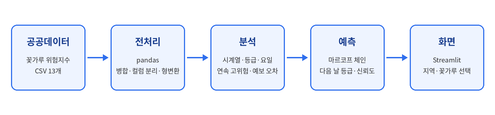
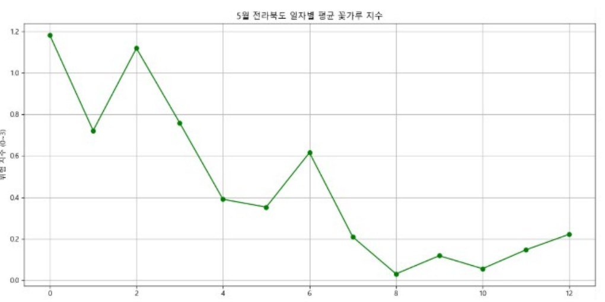
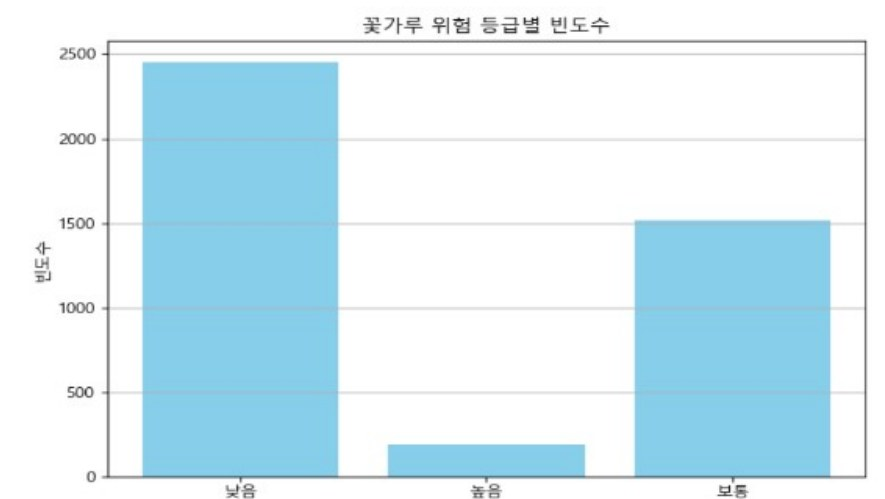
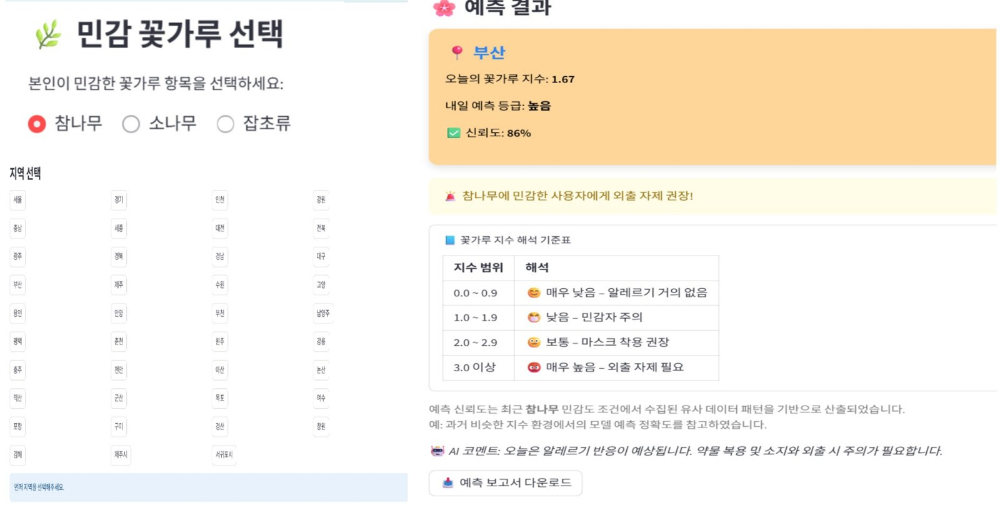

# 꽃가루 위험 예측 서비스

> 공공데이터로 꽃가루 위험 패턴을 분석하고, 알레르기 민감자를 위한 예측 웹 서비스로 만든 개인 프로젝트 · 2025.05.22 ~ 2025.06.17 · 데이터분석기초 기말 프로젝트

<br>

## 1. 프로젝트 개요

### 배경

미세먼지 정보는 날씨 앱이나 버스 정류장 안내판처럼 어디서나 쉽게 볼 수 있습니다.
반면 꽃가루 정보는 찾아보기 어렵고, 찾더라도 0~3 사이의 숫자 지수로만 제공됩니다.
알레르기가 있는 사람은 이 숫자만 보고 오늘 마스크를 써야 할지, 외출을 줄여야 할지 판단하기 어렵습니다.

### 목표

"내가 사는 지역에서, 내가 민감한 꽃가루가, 내일 얼마나 위험한가"를 한눈에 알려 주는 서비스를 만드는 것이 목표입니다.
이를 위해 두 가지를 진행했습니다.

1. 공공데이터를 분석해 꽃가루 위험이 언제, 얼마나 나타나는지 패턴을 확인한다
2. 분석 결과를 사용자가 바로 행동으로 옮길 수 있는 웹 서비스로 만든다

### 프로젝트 정보

| 항목 | 내용 |
|---|---|
| 기간 | 2025.05.22 ~ 2025.06.17 (총 약 41시간) |
| 인원 | 개인 |
| 데이터 | 기상청 꽃가루농도 위험지수 (공공데이터포털) |
| 분석 범위 | 2025.05.01 ~ 05.13 · 일별 파일 13개 · 전라북도 지점 4,160행 |
| 결과물 | 분석 노트북, Streamlit 웹 앱, 최종 발표 자료 |

<br>

## 2. 기술 스택

| 분야 | 사용 기술 | 고른 이유 |
|---|---|---|
| 언어 | Python | 수집부터 분석, 웹 화면까지 한 언어로 이어서 만들 수 있어서 |
| 데이터 처리 | pandas, NumPy, glob | 날짜별로 나뉜 CSV를 한 번에 읽고 문자열을 컬럼으로 나누기 쉬워서 |
| 시각화 | matplotlib, seaborn | 꺾은선, 막대, 히트맵을 같은 코드 흐름에서 바로 그릴 수 있어서 |
| 예측 | 마르코프 체인 | 데이터 기간이 짧아, 복잡한 모델보다 "오늘 등급 → 내일 등급" 확률이 설명하기 쉬워서 |
| 서비스 | Streamlit | 파이썬 코드만으로 사용자가 직접 고르는 화면을 빠르게 만들 수 있어서 |
| 개발 환경 | Jupyter Notebook, VS Code | 분석은 노트북에서 확인하고, 앱은 VS Code에서 실행 |

<br>

## 3. 구현 과정

전체 흐름은 다음과 같습니다.



### 3-1. 데이터 수집

공공데이터포털에서 기상청 꽃가루농도 위험지수 일별 CSV 파일 13개(2025.05.01 ~ 05.13)를 내려받았습니다.
데이터는 2022년부터 계속 갱신되고 있으며, 지점별로 오늘 · 내일 · 모레의 위험지수가 들어 있습니다.

### 3-2. 데이터 전처리

받은 데이터는 바로 분석할 수 없는 형태였습니다. 다음 순서로 정리했습니다.

1. 파일 병합: `glob`으로 `FCT_IDX_D06_v1_202505*.csv` 파일을 자동으로 찾아 하나의 표로 합쳤습니다.
2. 컬럼 분리: 한 칸 안에 `지수코드#지점번호#날짜#오늘#내일#모레`처럼 이어진 문자열을 `#` 기준으로 나눴습니다.
3. 형식 변환: `2025050218` 같은 숫자 문자열을 날짜형으로 바꾸고, 지수는 숫자형으로 바꿔 빈 값은 0으로 채웠습니다.
4. 지역 선택: 전국 데이터가 너무 커서, 지점번호가 46으로 시작하는 전라북도 데이터만 먼저 추출해 검증했습니다.
5. 등급 변환: 0~3 지수를 낮음 · 보통 · 높음 · 매우높음으로 바꾸고, 지수 2 이상이면 사용자 경고가 뜨도록 기준을 추가했습니다.

```python
df_split = df_all.iloc[:, 0].str.split("#", expand=True)
df_split.columns = ["지수코드", "지점번호", "날짜", "오늘", "내일", "모레", "종료"]
df_split["날짜"] = pd.to_datetime(df_split["날짜"], format="%Y%m%d%H", errors="coerce")
df = df_split[df_split["지점번호"].str.startswith("46")].copy()
```

### 3-3. 데이터 분석

정리된 4,160행으로 다섯 가지 질문에 답했습니다.

| 질문 | 분석 방법 |
|---|---|
| 언제 가장 위험했나? | 날짜별 평균 지수 (시계열) |
| 위험한 날은 얼마나 많나? | 위험 등급별 빈도 |
| 위험이 며칠씩 이어지나? | 3일 연속 고위험 구간 탐지 |
| 요일마다 차이가 있나? | 요일별 평균 지수 |
| 예보는 얼마나 안정적인가? | 모레 예보와 내일 예보의 평균 차이 |

| 일자별 평균 꽃가루 지수 | 위험 등급별 빈도 |
|---|---|
|  |  |
| 5월 초에는 평균 1 이상(보통)이었다가 5월 4일 이후 급격히 낮아집니다. | 절반 이상은 낮음이지만, 보통 이상도 40%가 넘습니다. |

### 3-4. 다음 날 등급 예측

마르코프 체인으로 "오늘 등급이 이것일 때 내일은 어떤 등급일까"를 확률로 계산했습니다.

1. 노트북에서 예시 등급 시퀀스로 전이 행렬, 히트맵, 높음 등급 지속 기간 분석 방법을 먼저 확인했습니다.
2. 앱에서는 실제 데이터의 오늘 지수 흐름으로 전이 행렬을 만들어, 가장 확률이 높은 내일 등급과 그 확률(신뢰도)을 보여 줍니다.

### 3-5. 서비스 기획과 구현

분석 결과를 사용자 입장에서 다시 바라보고, 화면에 필요한 기능을 정했습니다.

| 사용자 입장의 불편 | 서비스에서 이렇게 해결했습니다 |
|---|---|
| 0~3 숫자만 보고는 의미를 모르겠다 | 등급과 행동 가이드(마스크 착용, 외출 자제 등)로 바꿔서 보여 줌 |
| 사람마다 민감한 꽃가루가 다르다 | 참나무 · 소나무 · 잡초류 중 민감 항목을 직접 고름 |
| 민감자에게는 보통 수준도 부담된다 | 지수 2 이상이면 경고 메시지 표시 |
| 결과를 따로 보관하고 싶다 | 예측 보고서 CSV 다운로드 |

<br>

## 4. 결과

### 분석 결과

| 항목 | 결과 |
|---|---|
| 위험 등급 분포 | 4,160건 중 낮음 2,454건(59%), 보통 1,516건(36%), 높음 190건(4.6%) |
| 주의가 필요한 비율 | 보통 이상 1,706건, 전체의 41% |
| 시기별 변화 | 일별 평균 지수 1.18(5/1) → 0.03(5/9) |
| 요일별 차이 | 목요일 평균 0.70, 월요일 평균 0.27로 약 2.6배 차이 |
| 예보 안정성 | 모레 예보와 내일 예보의 평균 차이 0.28 (0~3 척도) |

이 결과로 두 가지를 확인했습니다.
첫째, 민감자에게 주의가 필요한 날이 열흘 중 네 번꼴로 적지 않았습니다.
둘째, 같은 기간 안에서도 날짜와 요일에 따라 위험도가 크게 달라, 미리 알려 주는 서비스가 의미가 있었습니다.

### 서비스 결과

지역과 민감 꽃가루를 고르면 오늘의 꽃가루 지수, 내일 예측 등급, 행동 가이드, 지수 해석 기준표가 한 화면에 나타납니다.



<br>

## 5. 문제 해결 경험

| 단계 | 내용 |
|---|---|
| 문제 | 내려받은 데이터를 바로 분석할 수 없었습니다 |
| 원인 | 파일이 날짜별로 13개로 나뉘어 있고, 한 칸에 모든 값이 `#`로 이어진 문자열로 저장되어 있었습니다 |
| 해결 | 파일 이름 패턴으로 자동 병합하고, `#` 기준으로 컬럼을 나눈 뒤 날짜와 숫자 형식을 바꿨습니다 |
| 결과 | 13개 파일을 4,160행의 한 표로 만들어 시계열 · 요일별 · 등급별 분석이 가능해졌습니다 |

<br>

## 6. 개인 기여도

개인 프로젝트로, 기획부터 분석, 개발, 발표까지 모두 직접 진행했습니다.

- 알레르기 민감자를 대상 사용자로 정하고 서비스 기능을 기획했습니다
- 공공데이터 13개 파일을 수집하고 하나의 분석용 표로 정리했습니다
- 다섯 가지 분석과 시각화를 수행하고 결과를 해석했습니다
- 마르코프 체인 예측 로직을 만들고 앱에 연결했습니다
- Streamlit으로 화면, 결과 카드, 보고서 다운로드 기능을 구현했습니다

<br>

## 7. 실행 방법

설치

```bash
pip install pandas numpy matplotlib seaborn streamlit
```

분석 노트북 실행

```bash
jupyter notebook pollen_analysis.ipynb
```

주의사항

- 원본 데이터는 공공데이터포털에서 `FCT_IDX_D06_v1_202505*.csv` 파일을 받아 노트북과 같은 폴더에 둡니다.
- 한글 그래프가 깨지면 노트북 상단의 폰트 설정(`Malgun Gothic`)을 사용하는 운영체제에 맞게 바꿉니다.

참고 자료

- [최종 발표 자료 (PDF)](docs/final_presentation.pdf)
- [분석 코드와 실행 결과 (PDF)](docs/analysis_code_report.pdf)

<br>

## 8. 회고와 다음 계획

이 프로젝트에서 가장 크게 배운 점은, 분석 결과를 숫자로 끝내지 않고 사용자가 실제로 무엇을 해야 하는지까지 연결해야 쓸모가 생긴다는 것입니다.
같은 0~3 지수라도 "마스크 착용 권장"처럼 행동으로 바꿔 보여 주자 서비스의 의미가 분명해졌습니다.

아쉬운 점과 다음 계획은 다음과 같습니다.

- 앱의 신뢰도는 전이 확률 값이며, 실제 다음 날 지수와 비교한 적중률은 아직 측정하지 않았습니다. 지난 데이터로 "며칠 중 며칠 맞혔는지"를 측정할 계획입니다.
- 예측 함수에서 전이 행렬을 곱하는 방향이 반대인 부분을 발견해, 이를 바로잡을 예정입니다.
- 13일 데이터로는 계절 흐름을 보기 어려워, 꽃가루가 많은 봄부터 가을까지 기간을 늘려 다시 분석하겠습니다.
